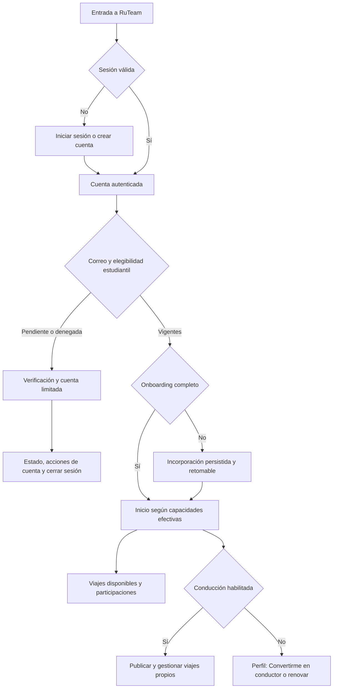

# Navegación y contenido por capacidades

Navegación del incremento local del 25/11/2026.
Una sola app Expo Router web/móvil. PRODUCT_DEFINITION y AUTHORIZATION_MATRIX son
la autoridad funcional; rutas/layouts componen vistas, Nest autoriza cada operación.
Las pruebas y las limitaciones de cada ruta se registran en la [revisión local](../reviews/PRODUCT_TRANSFORMATION_DELIVERY.md).

## Acceso y resolución de sesión

No interpretar error de red como usuario autenticado, verificado o sesión inexistente.
Mostrar carga/error/reintento; no bucles entre verificación y onboarding. Cuenta limitada
puede completar nombre/preferencia básica sin acceder a viajes. Movilidad se configura
cuando exista elegibilidad y puede omitirse; «Todos» permanece disponible después.
Restaurar avance del onboarding desde servidor tras recarga/reinicio. Retorno tras login
sólo a destinos internos autorizados, nunca a URL arbitraria.

## Áreas y destinos

| Área                     | Pantallas y contenido                                                                                                      | Control                                                                                 |
| ------------------------ | -------------------------------------------------------------------------------------------------------------------------- | --------------------------------------------------------------------------------------- |
| Pública/auth             | RuTeam, correo y contraseña propia, Iniciar sesión, Crear cuenta, recuperar/verificar acceso y privacidad                  | Sin selector de identidades ni botón desarrollo; sólo proveedores existentes            |
| Cuenta/verificación      | Estado de correo, acreditación académica pendiente/no elegible/vencida/revocada, causa comprensible y acciones disponibles | Sesión de cuenta; ningún feed ni menú de viajes si no elegible                          |
| Onboarding               | Identidad mínima, preferencia de uso, movilidad opcional y habilitación voluntaria                                         | Paso/estado persistidos; seleccionar conductor no concede permiso                       |
| Inicio pasajero          | Próxima participación, recomendaciones reales, Desde/Hacia USC, avisos y estados vacíos útiles                             | Estudiante vigente; perfil no es contenido principal                                    |
| Inicio conductor         | Próximos viajes propios, publicar, ocupación/participantes/propuestas y habilitación; también feed pasajero                | Distinguir viajes publicados de participaciones en viajes ajenos                        |
| Viajes disponibles       | Para ti, Desde USC, Hacia USC y Todos; tarjetas y detalle completos                                                        | Backend aporta estado, plazas, razones/calidad de coincidencia y datos mínimos          |
| Mis participaciones      | Próximas/en curso/historial/retiros/cancelaciones, encuentro y acciones del titular                                        | No confundir confirmación con abordaje ni mostrar acciones del propietario ajeno        |
| Conducción               | Publicar, mis viajes, participantes, propuestas y ciclo propio                                                             | Preferencia sin habilitación no muestra publicar; URL directa protegida también por API |
| Perfil/configuración     | Nombre/cuenta/verificación/capacidades, movilidad, seguridad, avisos, logout y Convertirme en conductor                    | Vehículos/documentos se acceden en su contexto, no de forma permanente para pasajero    |
| Notificaciones           | Bandeja propia, leído/no leído y detalle actual del viaje                                                                  | Persistentes internas; no afirmar push/tiempo real/correo por mostrarlas                |
| Mensajes/complementarios | Sólo módulos con operación funcional detrás y permisos de participante                                                     | No pestañas aparentemente activas de funciones pendientes                               |

## Adaptación de plataformas

Web: layout de aplicación con navegación lateral persistente cuando el espacio lo permite,
contenido amplio y jerarquía de tarjetas/detalle; evitar un formulario estrecho como marco
de todas las pantallas. Móvil: pestañas inferiores de funciones principales, pantallas
secundarias para perfil/configuración/detalles y acción de publicar según capacidad.
No meter todas las opciones en la barra ni crear apps o features duplicadas.

Las capacidades del servidor determinan contenido y acceso. Una pérdida de conducción
retira publicación/START, conserva pasajero si matrícula vigente y orienta renovación.
Pérdida de elegibilidad pasa a cuenta/verificación, limpia datos protegidos y mantiene
logout. Actualizar navegación al revalidar sesión, sin depender sólo de un snapshot local.

Detalle propio muestra gestión; detalle lleno/cerrado informa estado; quien participa ve
su participación; potencial HACIA_USC propone punto sin prometer plaza; compatible puede
confirmar. Actualizar disponibilidad con resultado real, en particular tras409/reintento.
No botón funcional sin acción/backend ni reputación/estadística/ETA inventadas.

## Evidencia requerida

Escritorio y viewport móvil: login, registro, verificación, onboarding, ambos inicios,
feed/general/detalle, publicación, participaciones, propios, avisos, perfil, movilidad y
habilitación. Inspeccionar capturas y recorrer teclado/táctil, carga/empty/error, overflow,
retorno y menús por capacidad. Probar ausencia de controles de conductor en pasajero,
su presencia para habilitado y bloqueo de acceso directo. Viewport/export no prueba
Expo Go físico. Registrar pantallas o flujos aún pendientes, sin «listo» global.

## Rutas implementadas

- `/` resuelve login, verificación, onboarding o Inicio según sesión y capacidad.
- `/register`, `/recover-access`, `/verify-email` y `/privacy` son entradas públicas
  o de sesión limitada según la operación.
- `/onboarding` retoma el avance en el backend y permite acceder a movilidad y
  documentos propios cuando ya hay elegibilidad.
- `/available-trips`, `/trip/[id]`, `/my-reservations`, `/notifications`, `/profile`
  y `/mobility` corresponden a estudiantes elegibles. `/search-trips` conserva
  filtros secundarios.
- `/publish` requiere capacidad actual de conducción. `/my-trips` y `/vehicles`
  ofrecen historial y renovación en contexto de conducción.

## Superficies del corte de consolidación

- `/ratings` y `/ratings/[tripId]` abren reputación propia, destinos de evaluación
  y registro de estrellas desde Perfil, historial de viaje o avisos.
- `/groups` muestra invitaciones, consentimientos y resultados propios. El
  formulario de creación vive en el tramo elegido del viaje.
- `/safety/[tripId]` muestra contexto en curso, posición cuando esté disponible y
  controles explícitos de compartir o confirmar una llamada.
- `/expenses/[tripId]` permite al conductor consultar y editar su estimación privada.
- Mis viajes y Mis participaciones alojan escáner nativo, pase QR y el abordaje manual.
