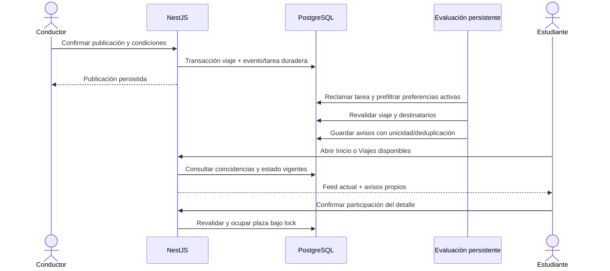

# Preferencias, recomendaciones, feed y notificaciones

Corte local, 25/11/2026. La implementación se verifica en la [revisión de entrega](../reviews/PRODUCT_TRANSFORMATION_DELIVERY.md). Fuentes: PRODUCT_DEFINITION, BUSINESS_RULES y AUTHORIZATION_MATRIX.
Matching recomienda viajes del conductor; no solicita transporte, rediseña rutas ni reserva.
Mantener Nest MVC/Prisma/PostgreSQL y una app Expo, sin infraestructura externa obligatoria.

## Responsabilidades y datos

Preferencias: datos privados del estudiante elegible (campus, zona/lugares aproximados,
sentido, días/franjas, distancia aceptable, avisos), con activación/edición/eliminación y
más de una preferencia cuando sea necesario. No domicilio exacto obligatorio ni coordenadas
manuales. No exponer zonas habituales a conductores/otros pasajeros. No se publican solicitudes.

Matching: prefiltra campus/sentido/tiempo/estado/capacidad/elegibilidad en PostgreSQL y
luego evalúa calidad geográfica, geometría y puntos autorizados. Limitar trabajo y páginas,
usar índices acordes al plan real; no barrer todas las cuentas en cada petición HTTP.
No inventar horarios intermedios sin dato/estimación disponible. Texto y geografía se distinguen.

Feed: lecturas actuales autorizadas Para ti/Desde/Hacia/Todos. Sin preferencias devuelve
estado explicativo y acceso a Todos, no un panel vacío obligatorio. Tarjetas y detalle
presentan datos mínimos reales; no correo/placa/documentos/domicilio innecesarios, reputación
falsa o disponibilidad inventada. Viaje propio no es recomendación pasajero para su dueño.

Notificaciones: destinatario, viaje/tipo/coincidencia, timestamp, leído y clave de deduplicación.
Inicialmente internas persistentes en PostgreSQL; no afirmar sockets, push, SMS o correo.
Un aviso abre detalle actual y autorizado; nunca plaza, confirmación ni permiso automático.

## Calidad de compatibilidad

| Resultado                           | Fundamento                                                                                                                  | Acción posible                                                                          |
| ----------------------------------- | --------------------------------------------------------------------------------------------------------------------------- | --------------------------------------------------------------------------------------- |
| Compatible para participar          | Condiciones actuales y par de paradas autorizadas en orden; estudiante elegible, viaje futuro abierto con plazas            | Abrir detalle y confirmar transaccionalmente; recomendación no garantiza plaza futura   |
| Potencialmente compatible           | Geometría próxima con evidencia suficiente, pero falta recogida autorizada; sólo HACIA_USC cuando su política lo permite    | Proponer punto, dueño decide; aceptar no confirma ni ocupa plaza                        |
| No compatible o datos insuficientes | Sentido/fecha/horario/campus/estado/capacidad/eligibilidad no satisfacen condiciones, o calidad no demuestra compatibilidad | No presentarlo como participación autorizada; puede descubrirse en Todos cuando proceda |

Proximidad a paso o línea no autoriza abordar allí. Coincidencia de nombres no prueba
cercanía exacta. Punto interior sin GPS propio usa relación campus/texto, no coordenada
inventada. Aceptar propuesta actualiza paradas de manera compatible sin cambiar geometría;
participar sigue siendo una operación posterior con nueva disponibilidad.

## Publicación y efectos recuperables

El feed consulta compatibilidad vigente. Para avisos, el worker reclama un job en PostgreSQL
con `FOR UPDATE SKIP LOCKED`, lease de 30 segundos y cursor por preferencia. Los lotes de
hasta 50 guardan avisos y avanzan el cursor en una transacción. Si vence el lease, se puede
reclamar la tarea; el worker aplica reintentos con backoff limitado. La clave única
destinatario/viaje/tipo deduplica avisos entre reintentos y preferencias coincidentes.

Publicar crea el job en la misma transacción. Liberar plaza o aceptar una recogida reencola
el trabajo y conserva los avisos existentes y su lectura. El feed recalcula cuando cambia
una preferencia; el worker evita enviar avisos retroactivos masivos al editarla. Al iniciar,
se recorren en lotes las publicaciones futuras previas sin trabajo asociado. No hay
dependencia de que el cliente permanezca abierto.

## Invalidación y consistencia

| Cambio                                    | Comportamiento requerido                                                                                       |
| ----------------------------------------- | -------------------------------------------------------------------------------------------------------------- |
| Publicación nueva                         | Feed la considera y evaluación de avisos ocurre sin búsqueda manual del estudiante                             |
| Cancelación/completado/inicio/cierre      | Dejar de ofrecer participación; detalle enlazado conserva estado real/historial                                |
| Viaje lleno o plaza liberada              | Recalcular disponibilidad al leer y al confirmar; ninguna recomendación vende plaza por sí sola                |
| Preferencia editada/desactivada/eliminada | Recalcular Para ti; no avisos futuros que dependan de preferencias inactivas; política de históricos explícita |
| Parada aceptada                           | Revalorar compatibilidad autorizada sin cambiar geometría ni confirmar al proponente                           |
| Elegibilidad/capacidad cambiada           | Revalidar destinatario y operaciones; no feed privado ni avisos de viajes nuevos a no elegibles                |
| Sesión distinta/logout                    | Cancelar/invalidar caché privada y aislar notificaciones/preferencias entre identidades                        |

Los avisos antiguos no prometen que el viaje siga disponible. Reconsultar detalle y
aplicar permisos actuales en todo enlace. Guardar lectura pertenece al destinatario,
no a cualquier usuario con un ID de notificación. Validar cursor/límites sin revelar datos
excluidos. Considerar retención y eliminación de preferencias como datos personales.

## Evidencia requerida

Publicar desde otra cuenta→feed sin búsqueda→aviso único persistente→detalle→confirmación
→disponibilidad actual. Probar no coincidente en Todos pero fuera de Para ti, preferencia
omitida/inactiva, potencial sin recogida, cambio de estado, reintento/reinicio, ausencia de
notificación propia, permisos/datos privados ajenos y fallo de proveedor visible.
Medir consultas/volumen reales antes de afirmar RNF-031 o escalabilidad. SMTP, tiempo real,
push y Expo Go físico tienen comprobaciones separadas; no inferirlas de bandeja interna.
