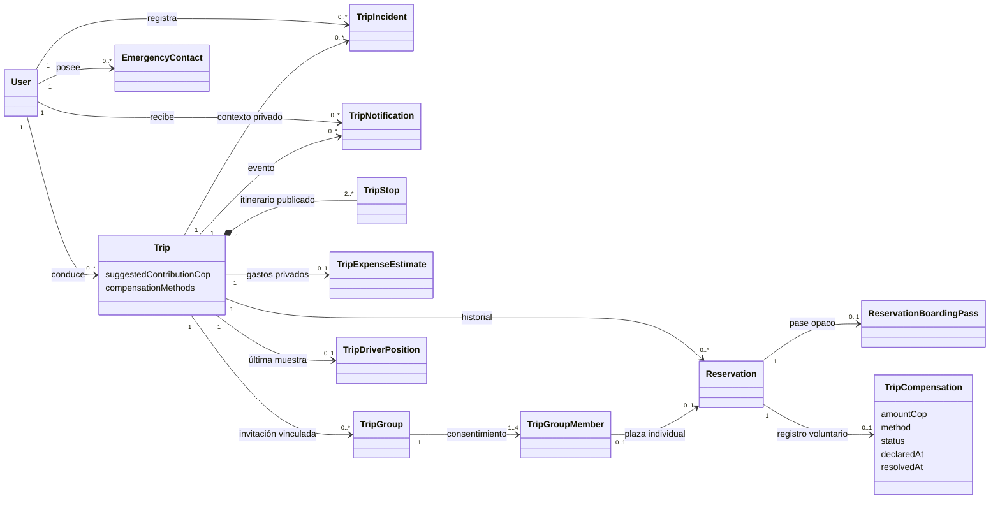
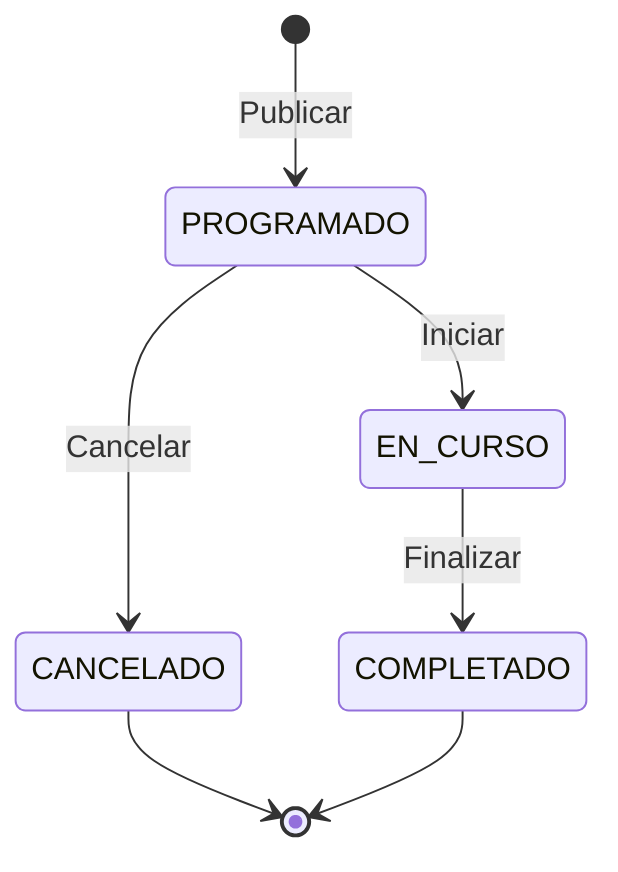
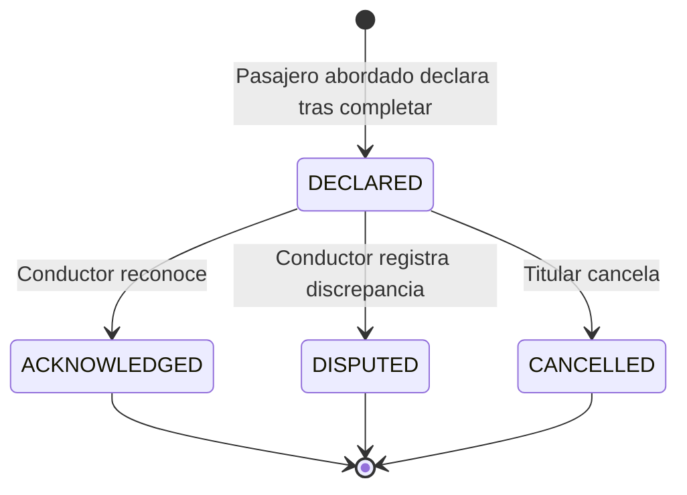
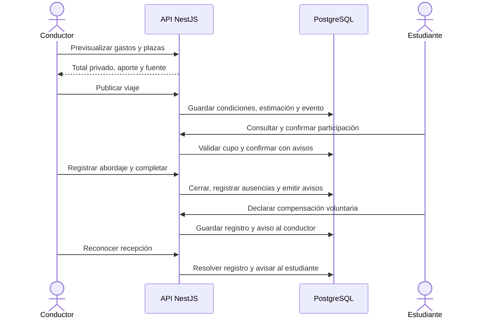

# UML derivado del cierre del 26/11/2026

Este derivado conecta RF-006, RF-008/009, RF-011, RF-012, RF-014, RF-015,
RF-027 y RF-030 con los modelos y flujos del corte. El
[cotejo histórico](UML_CROSSWALK.md) conserva las pestañas del original.

## Clases

(2..*) aplica al itinerario publicado en el flujo vigente. Las filas históricas
pueden provenir del modelo anterior. La cardinalidad de consentimientos activos
se limita por plazas. Los consentimientos retirados se conservan como historial.

## Estados

## Secuencia de publicación y aportes

Se renderizaron y revisaron visualmente en Chromium las cuatro figuras. El
material de revisión se conserva en el directorio privado de evidencia.
