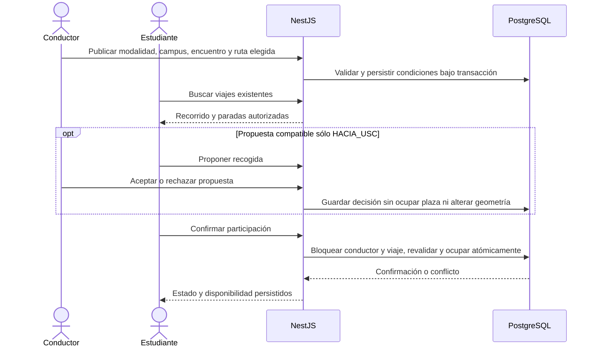
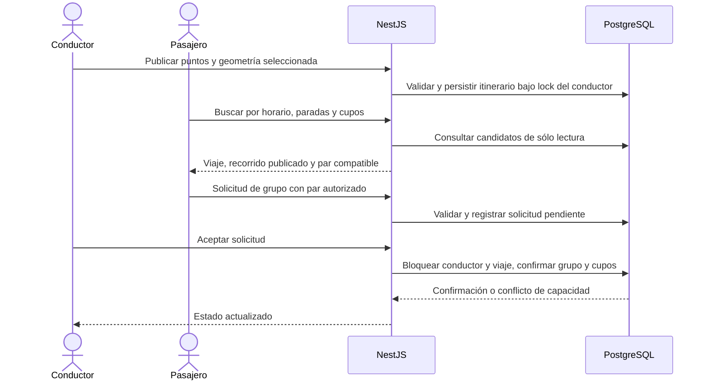

# UML y redefinición vigente del 25/11/2026

Consultar PRODUCT_DEFINITION antes de implementar. Este crosswalk conserva el índice
original00–35 y el cotejo histórico; las modificaciones actuales se especifican abajo.
No inventa números de diagramas, nuevos RF/HU oficiales ni aprobaciones académicas.

Originales privados recuperados localmente25/11: ERS .doc, UML .drawio de 36 pestañas
XML no comprimidas y rúbrica .pdf; hashes coinciden con el cotejo conservado. El acceso
actual corrige el bloqueo de fuentes ausentes registrado24/11. No significa que sus
originales ya estén editados, sincronizados ni aceptados. Product/Sprint Backlog y actas
originales no localizados. No versionar originales ni conversiones con PII.

| Pestañas verificadas del original | Modificación vigente requerida                                                                                                                                                                                                                    |
| --------------------------------- | ------------------------------------------------------------------------------------------------------------------------------------------------------------------------------------------------------------------------------------------------- |
| 00,01,13,14,27,32                 | Sólo estudiante vigente, identidad/capacidades compatibles, sin actor/permiso ADMIN. Separar control de correo/autenticación/estamento/matrícula/conducción; fuente autorizada falla cerrada                                                      |
| 02,04,15,33                       | DESDE_USC/HACIA_USC, campus como extremo institucional. Encuentro textual libre y coordenada interior opcional; referencias aproximadas explícitas. Conductor elige/persiste ruta y condiciones; eliminar externo→externo con USC sólo intermedia |
| 03,23,24,25,26                    | MVC modular Nest/Prisma/PostgreSQL + única app Expo, providers/contratos; retirar panel/servicio ADMIN, sin confundir operación de infraestructura con actor funcional                                                                            |
| 05,16,31,35                       | Reemplazar Solicitar→aceptar por confirmación directa. Validar y bloquear conductor→viaje, confirmar/ocupar atómicamente, reintento sin duplicar. Grupo sólo con consentimiento temporal explícito; pendientes históricos no se promueven         |
| 07,12,22                          | Matching descubre viajes existentes por sentido/fecha/paradas/capacidad y calidad geométrica/textual. Sin solicitudes de transporte ni generación de rutas por pasajeros. Paso≠parada autorizada                                                  |
| 08,11,17,28                       | Separar viaje/ocupación/participación/presencia; retiro futuro permitido libera cupo y conserva historia, cancelación/inicio/final con actores/precondiciones. Condiciones esenciales no cambian silenciosamente; sin multas automáticas          |
| 09                                | Abordaje exige participación confirmada, sin consumir otra plaza. QR interno específico con expiración/uso único, distinto del carné USC                                                                                                          |
| 21                                | Autogestión vehículo/documentación y elegibilidad sin revisor ADMIN; separar declaración/formato/vigencia/fuente legítima. Preservar auditoría anterior sin permisos operativos                                                                   |
| 06,10,18,19,20,29,30,34           | Conservar economía sin lucro, SOS, chat, calificaciones e incidentes compatibles. Acceso por interacción/participación real; retirar derivaciones a ADMIN y explicitar soporte externo pendiente                                                  |

Propuesta HACIA_USC: insertar concepto y secuencia de propuesta→decisión propietario
separados de confirmación, en las vistas de viaje/paradas/participación pertinentes.
No atribuirle número de pestaña inexistente; el autor decide crear o adaptar una vista
con identidad estable al editar el original. Aceptar no cambia geometría, no ocupa plaza
y no confirma. El pasajero confirma después con disponibilidad.

La [especificación académica](ACADEMIC_REDEFINITION_CHANGES.md) define aceptación de
las ediciones; TRACEABILITY/TEST_PLAN enlazan implementación y pruebas requeridas.
Este diagrama representa comportamiento acordado, no prueba de código completo.

## Índice, cotejo y propuestas históricas 13–24/11

El bloque siguiente conserva las36 pestañas y firmas observadas en aquellos cortes.
Sus correspondencias de código/estados y propuestas24/11 quedaron sustituidas cuando
contradicen la definición25/11; no usar ADMIN, aceptación ordinaria, coordenadas manuales
o USC sólo intermedia como precondiciones vigentes.

# UML ↔ código y divergencias verificadas

Cotejo2026-11-13 America/Bogota. Fuente privada UML_RuTeam_Final.drawio, XML completo:
36/36 pestañas recorridas; etiquetas de clases, atributos, firmas, relaciones con source/target,
mensajes y reglas extraídos localmente. Diagramas con flechas geométricas sin terminales
XML se interpretaron por sus participantes/mensajes, no se inventaron IDs de relación.
No se modificó el original. Índice usa número visible de pestaña00–35 (posición XML1–36).

SHA256 UML:7d6efaa83cbc440b0cf784829f729ba7cc50277ce4f49c67e94d74f281c1b98a.
SHA256 rúbrica:2e6a1a7b53cdd502562b62b35bfd8f59779d9a7f2bcdab570c494b31c1a03ffe.
ERS: ver ERS_CATALOG. Originales ignorados; compartir por canal privado autorizado.

## Índice completo leído

- 1. 00 · Guia, trazabilidad y decisiones
- 2. 01 · Clases - identidades y seguridad
- 3. 02 · Clases - viajes y compensaciones
- 4. 03 · Clases - arquitectura MVC
- 5. 04 · Secuencia - Publicación de viaje
- 6. 05 · Secuencia - Reserva y aceptación
- 7. 06 · Secuencia - Finalización y división de costos
- 8. 07 · Secuencia - Búsqueda y matching
- 9. 08 · Secuencia - Cancelación, penalidad y soporte
- 10. 09 · Secuencia - Abordaje con código QR
- 11. 10 · Secuencia - SOS y contacto de emergencia
- 12. 11 · Estados - Vida completa del Viaje (REDISEÑADO)
- 13. 12 · Actividades - Matching y solicitudes USC (REDISEÑADO)
- 14. 13 · Clases - Afiliación y acceso USC
- 15. 14 · Clases - Roles y permisos
- 16. 15 · Clases - Campus, rutas y paradas
- 17. 16 · Clases - Reservas para grupos
- 18. 17 · Clases - Recorrido y seguimiento
- 19. 18 · Clases - Liquidación sin fines de lucro
- 20. 19 · Clases - Chat y avisos
- 21. 20 · Clases - Calificaciones e incidentes
- 22. 21 · Clases - Vehículos y cumplimiento
- 23. 22 · Clases - Políticas de matching
- 24. 23 · Arquitectura - componentes
- 25. 24 · Arquitectura - capas y dependencias
- 26. 25 · Arquitectura - despliegue y seguridad
- 27. 26 · Arquitectura - equipo, decisiones y normas
- 28. 27 · Secuencia - Verificación institucional de acceso
- 29. 28 · Secuencia - Viaje en curso y múltiples paradas
- 30. 29 · Secuencia - Calificación bidireccional
- 31. 30 · Secuencia - Chat autorizado por viaje
- 32. 31 · Secuencia - Solicitud de grupo y último cupo
- 33. 32 · Clases - aplicación Afiliación institucional
- 34. 33 · Clases - aplicación Viaje y paradas
- 35. 34 · Clases - aplicación Chat y calificaciones
- 36. 35 · Clases - aplicación Reservas y cupos

## Firmas y entidades relacionadas con el código real

| UML (pestañas) | Contrato/firma de fuente                                               | Código real                                                                      | Correspondencia/límite                                                                         |
| -------------- | ---------------------------------------------------------------------- | -------------------------------------------------------------------------------- | ---------------------------------------------------------------------------------------------- |
| 01,13,14,27,32 | Usuario/VinculoInstitucional/SesionApp; revalidarAfiliacion(usuarioId) | User/InstitutionalMembership/AuthSession; provider.verify y SessionGuard         | Nombres ingleses de fundación conservados; DEMO, oficial bloqueado                             |
| 01,21          | Vehiculo.validarCapacidad(n), esPublicable(fecha)                      | Vehicle + VehiculoPolicy.validarCapacidad/esPublicable                           | Capacidad de pasajeros1..4/1 y revisión/vigencia hasta fin DEMO                                |
| 21             | SOAT.estaVigente(fecha), verificarFuente()                             | VehicleDocument, VehiculoService.revisarVehiculo                                 | SOAT_DEMO, aprobación manual admin; verificarFuente oficial NO implementado                    |
| 14,21          | Conductor, LicenciaConduccion.habilita(tipo,fecha)                     | DriverEligibility/category/reviewStatus y capacidades auth/me                    | Capacidades coexistentes sin herencia de tablas; enum sintético CAR/MOTORCYCLE/BOTH            |
| 03,04          | ViajeController/ViajeService.publicarViaje(conductorId,datos)          | ViajeController.publicarViaje(req,dto), ViajeService.publicarViaje(driverId,dto) | Actor sale de sesión; HTTP201 corrige texto UML «200 Created»                                  |
| 03,04          | ViajeRepository.guardar(viaje)                                         | ViajeRepository.withDriverLock y unidad.save                                     | Nueva unidad transaccional; lock de conductor controla solapamiento concurrente                |
| 02,15          | Ruta.origen, destinoCampusId, ParadaRecogida.posicion/ubicacion        | Trip.origin*/destinationId, TripStop.position/lat/lon                            | Ruta embebida en agregadoTrip, sin entidadRuta/LineString ni ETA real; datos DEMO              |
| 11             | PROGRAMADO{Disponible,Lleno}, EN_CURSO, COMPLETADO,CANCELADO           | TripStatus y Viaje.ocupacion                                                     | Sólo creación PROGRAMADO+PUBLISHED; no transiciones ni reservas en Fase2                       |
| 02,04          | ReglaViaje/catálogo                                                    | TripRuleDefinition/TripRuleSelection y GETtrip-rules                             | DEFAULT y convivencia; no políticas género/penalidad                                           |
| 17             | EventoViaje.persistir()                                                | TripEvent PUBLISHED                                                              | Evento en misma transacción; gateway/outbox de entrega futuros                                 |
| 16,31,35       | SolicitudCupo/Reserva/InventarioCupos; consumirAtomico(N,version)      | No implementado                                                                  | La versión/ocupación deTrip sólo prepara contrato futuro; no asignación ni test de último cupo |
| 18,06          | CostoViaje/Liquidacion/Aporte; distribuirPorTramos                     | No implementado                                                                  | Propuesta pendientePO; no costo hardcodeado al publicar                                        |
| 19,20,29,30,34 | Chat/Calificacion/PQRS/SOS                                             | No implementado                                                                  | No sockets, pagos o reputación ficticios                                                       |
| 23–26          | monolito modular, dependencias, despliegue, equipo                     | Nest/Prisma/Expo+contratos; docs de equipo                                       | No Vue, microservicios, cloud, PostGIS/push obligatorios                                       |

## Divergencias y decisiones explícitas

- Precedencia: decisiones del equipo/prompt > UML compatible > ERS/rúbrica.
- UML23/25 incluye Admin Vue; equipo exige una app Expo Web/Native. Se mantiene Expo.
- UML26 propone feature/_; rama literal feature obliga a task/_. Sin merges/push automáticos.
- RF-003 menciona Active/Pending; se crea PROGRAMADO con ocupación derivada, como UML11.
- RF-003 exige (salida−30min)>ahora; se conserva estricto. Duración simulada5..360min es
  decisión técnica reversible para detectar intervalos; no distancia/routing/ETA de carretera.
- UML04 espera cálculo de ruta y aporte al publicar: pendientes de fases de mapas/economía,
  no sustituidos por números ficticios. RF-003 queda parcial por mapa/routing.
- RF-007 se contradice >30/<30; UML08 interpreta<30 como PROPUESTA: no se activa.
- RF-008 divide por cupos; UML18 propone tramos incluyendo conductor: decisión PO abierta.
- RF-021/025, norma moto y exclusividad: configuración jurídica pendiente, sin filtros automáticos.
- RF-010 usa5>estrellas>1 y promedio defectuoso; UML propone1..5: pendiente fuera de alcance.
- RF-024 exige archivo y revisión; demo usa metadatos sintéticos sin recopilar archivos reales.
- RF-029 admite destino externo excepcional; el producto fija destino exclusivamenteUSC.
- RNF-038 AES para contraseñas se corrige aArgon2id cuando existan; no AES reversible.
- RNF-047 iOS14 se documenta excepción por SDK 54/iOS15.1+. No teléfono físico probado.
- RQ-ACC-01/RQ-GRUPO-01/RQ-RUTA-01 son extensiones UML, no RF nuevos de la ERS.

## Rúbrica verificada (4 páginas)

Entrega 28/11/2026; equipo6; ERS30RF+20RNF+matriz y HU con100%criterios Given/When/Then;
UML2.5 consistente (8–10clases,≥4secuencias y estados/actividades), MVP+pruebas de
costos/validación, GitFlow y evidencia real de2sprints. Rúbrica distingue≤50% y>50%
funcionalidades, sin definir ponderación por RF: NO inferir cumplimiento por sincronizar50filas.
Exige evidencias semanales y participación de todo el equipo; no se fabrican ceremonias,
entrevistas, fotos, burndown ni tablero. Registro de entrevistas contiene PII y debe seguir
privado; no se versiona aquí. Permisos de publicación del repo se confirman por equipo.

## Nota de auditoría y diseño posterior — 2026-11-13

Sin nuevas divergencias de runtime en esta intervención. API.md aclara que Trip.version
es interno y no parte de TripSummary; no cambió la firma HTTP. Las entidades propuestas
SolicitudCupo/Reserva/ParticipanteReserva/InventarioCupos se mapearán a
ReservationRequest/Reservation/ReservationMember/claims transaccionales al implementar
el [plan de Fase 3](../development/FASE3_RESERVAS_PLAN.md), después de revisión autorizada.
Ese mapeo es propuesto, no una sincronización de esquema o firmas ya implementada.

## Correspondencia de rutas — 2026-11-14

Los nombres/clases/firmas y relaciones UML no cambian: el mismo sufijo de apps/api/src
se encuentra bajo backend/src; apps/client/app y src pasan a frontend/app y frontend/src.
No nueva jerarquía MVC global o reimplementación de módulos. Rutas propuestas de Fase 3
actualizadas sólo en su plan; reservas continúan sin implementar. Ver REPOSITORY_STRUCTURE
y ARCH_REFACTOR_REVIEW para equivalencia exacta y excepciones configuracionales.

## Especificaciones para actualizar los originales — 2026-11-24

Las pestañas se citan por su código cotejado. Los archivos XML/drawio originales faltan en este checkout. Mantener su notación, IDs y diagramas ajenos al cambio.

| Pestañas                                   | Edición precisa                                                                                                                                                                                                                                                                                                                                                                                  |
| ------------------------------------------ | ------------------------------------------------------------------------------------------------------------------------------------------------------------------------------------------------------------------------------------------------------------------------------------------------------------------------------------------------------------------------------------------------ |
| 00, 02, 15, 33                             | Reemplazar la obligación de `destinoCampusId`. Mostrar `CampusDestination` con tipo, nivel, acceso y coordenadas opcionales, y `TripStop` con identidad del punto y snapshot por viaje. Mostrar 2..12 posiciones para itinerarios nuevos, sólo paso separado de ambos permisos y GeoJSON/metros opcionales en `Trip`. Mantener `destinationId` opcional para relaciones de catálogo e historial. |
| 03, 04                                     | Miembro activo selecciona sus puntos, puede solicitar alternativas de OSRM, ve el resumen y confirma. Modelar un bloque opcional de motor disponible. El servicio resuelve catálogo, comprueba documentos, capacidad e intervalo bajo lock del conductor y guarda puntos, geometría y evento en una transacción.                                                                                 |
| 07, 12, 22                                 | Actor pasajero consulta filtros. Servicio selecciona candidatos programados futuros y pares de paradas en sentido correcto. Calcular Haversine sólo sobre puntos habilitados y retornar el par y el itinerario de lectura. Rama de cero coincidencias y continuación del cursor. Eliminar flujos que añadan desvíos o autoricen abordar sobre la línea.                                          |
| 05, 16, 31, 35                             | `Reservation` con 1..4 `ReservationMember`, dos paradas del mismo viaje y condición de sentido. Solicitud y confirmación son estados del mismo agregado. Modelar el lock del conductor y después el del viaje. Aceptar reserva todos los cupos o falla sin modificar ocupación. Conservar rechazo y retiro.                                                                                      |
| 08, 11                                     | Estados de viaje y ocupación derivada se mantienen independientes. Cancelación sólo desde PROGRAMADO, propaga cancelación de reservas activas y restaura disponibilidad registrada. Inicio cierra pendientes. Penalidad y cancelación individual confirmada quedan en la rama de política PO sin implementación.                                                                                 |
| 09, 17, 28                                 | La especificación de abordaje futuro recibe `reservationId` y `pickupId` autorizados. Separar preparación de QR/GPS y telemetría del itinerario estático. Inicio y finalización son comandos del propietario en este corte.                                                                                                                                                                      |
| 00, casos de uso de publicación y búsqueda | Actualizar actores y precondiciones. Conductor activo diseña el viaje. Pasajero encuentra y elige paradas del viaje. Identidad USC, reserva bidireccional y administración documental se mantienen.                                                                                                                                                                                              |

## Ajuste de trazabilidad 25/11/2026 | transformación

En identidad y acceso, modelar `User` → `AccountToken` → `AuthSession` y una barrera de
matrícula aparte del control de buzón. Mostrar onboarding con avance persistido y capacidad
efectiva calculada. En búsqueda y notificación, asociar `MobilityPreference` a cuenta y
campus, `RecommendationJob` a viaje y `TripNotification` a destinatario/viaje. A partir de
una coincidencia potencial, la propuesta de recogida antecede a una confirmación distinta.
Los diagramas privados originales permanecen íntegros. La
[especificación académica revisable](ACADEMIC_REDEFINITION_CHANGES.md) registra las divergencias.

## Continuidad, 26/11/2026

Relacionar sede con sus puntos y conservar su snapshot en cada parada de viaje.
Separar offset previsto por el motor de inicio, llegada, abordaje, ausencia y cierre
registrados. Añadir secuencia de chat con validación de participante, mensaje único,
marca monotónica y aviso en PostgreSQL. El DER usa las tablas TripChatMessage,
TripChatRead y TripNotification. Conservar el UML privado original para su revisión.

## Correspondencia de consolidación, 26/11/2026

La revisión deriva de las vistas numeradas abajo. Los identificadores de la
fuente histórica se conservan y el archivo original de 36 pestañas permanece
intacto.

| Pestañas históricas | Firmas, entidades y divergencia del corte                                                                                                                                                                                                                      |
| ------------------- | -------------------------------------------------------------------------------------------------------------------------------------------------------------------------------------------------------------------------------------------------------------- |
| 20, 29, 34          | `TripRating` y `RatingsService` modelan conductor ↔ pasajero abordado para `COMPLETADO`. El promedio es aritmético, agrupa por capacidad y se calcula sobre notas enteras 1–5. El comentario queda en la vista del evaluador.                                  |
| 16, 31, 35          | `TripGroup` y `TripGroupMember` separan consentimiento de confirmación. `GroupsService.confirm` revalida a todos y crea una `Reservation` individual por integrante bajo el bloqueo conductor → viaje.                                                         |
| 09, 17, 28          | `ReservationBoardingPass` guarda el hash del código que se valida para participación, viaje y parada. El QR y la presencia manual comparten la regla de abordaje. `TripDriverPosition` representa la última posición voluntaria visible sólo durante el viaje. |
| 10, 19, 30          | `TripSafetyContext` sólo expone contexto mínimo a quien tiene acceso al viaje activo. El usuario elige si comparte o abre el marcador. Los avisos `GROUP_CONFIRMED` y `RATING_AVAILABLE` se vinculan al viaje.                                                 |
| 02, 06, 18          | `TripExpenseEstimate` solamente suma costos privados del conductor. La liquidación y la fórmula de aporte siguen sujetas a decisión.                                                                                                                           |

El derivado privado de esta revisión identifica cada relación con esos
modelos y los flujos correspondientes. Su alcance se enumera en
[ediciones académicas](ACADEMIC_REDEFINITION_CHANGES.md#diagramas-derivados-de-consolidación).

## Derivado de cierre del 26/11/2026

Las observaciones de las pestañas originales siguen siendo antecedentes.
RF-008 y RF-009 adoptan la división por plazas ofertadas más conductor y la
declaración individual posviaje. RF-011 añade contactos propios e incidencias
privadas. Revisar el [derivado UML](RELEASE_UML.md) junto con la
[migración y el modelo](../architecture/DATA_MODEL.md).
